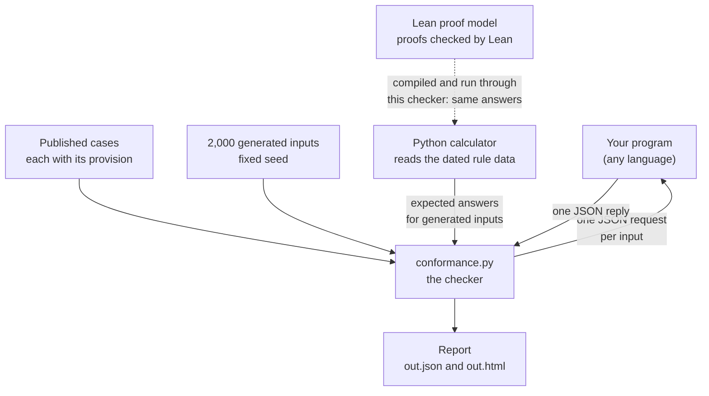
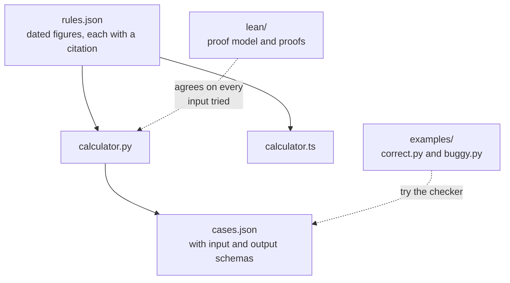

# UK tax rules checker

Check tax software against published test cases for two UK tax rules: the
income tax personal allowance (Income Tax Act 2007 s35) and the standard
residential rates of Stamp Duty Land Tax. Every expected answer cites the
provision it rests on.

This is a prototype by Williams Initiatives Ltd. It is not HMRC software and
not tax advice, and the cases have not yet been reviewed by a tax professional.

## How it fits together



Each rule lives in its own folder under `areas/`, and everything else is shared:



## What is here

Shared:

- `conformance.py`: the checker. It runs your software on every published case
  and on generated inputs, many at or one pound either side of a band boundary,
  and reports each difference with its provision.
- `ts/`: the shared TypeScript code (exact decimals, the in-page calculator and
  a runner for the TypeScript calculators).
- The other Python files support the checker and its report.

For each rule, in `areas/<rule>/`:

- `rules.json`: the dated rule data.
- `calculator.py` and `calculator.ts`: the reference calculators, which agree.
- `cases.json`, `input.schema.json`, `output.schema.json`: the published cases
  and the request and reply formats.
- `lean/`: the proof model, its proofs, the record of their check, and a small
  program that runs the model on one JSON request.
- `examples/`: a correct example program and one with a deliberate mistake.

See LICENSE: MIT for the code, the Open Government Licence for the rule data
and cases.

## Run it

Keep the directory layout. From this directory, use Python 3.10 or later with
its standard library. Try both correct programs:

```sh
python3 -I conformance.py personal_allowance --cmd "python3 -I areas/personal_allowance/examples/correct.py" --code areas/personal_allowance/examples/correct.py --samples 12 --report pa.json
python3 -I conformance.py sdlt --cmd "python3 -I areas/sdlt/examples/correct.py" --code areas/sdlt/examples/correct.py --samples 12 --report sdlt.json
```

`--samples 12` keeps this first try quick: it adds 12 generated inputs to the
published cases, and the checker says it is not the full published check.
Replace both occurrences of `correct.py` with `buggy.py` to see a failure.

For your own program, pass its command to `--cmd` and the files that do the
calculation to `--code`, and leave out `--samples` and `--seed`. That runs the
full published check: every published case and 2,000 generated inputs chosen
by the published seed, so every supplier is checked on the same inputs. The
checker prints "Full published check." and the report records
`"full_check": true`. With `--code`, the report also records the fingerprint of
those files, so it says which code passed. The checker sends one JSON request
per process and expects one JSON reply. A pass exits 0. A mismatch exits 1 and
appears in both the JSON report and the HTML report beside it.

Two other ways to connect:

- `--url URL` sends each input as JSON to your web service.
- `--export-inputs inputs.json` writes every input for a seed, and
  `--answers answers.json` compares your answers. A file of answers shows
  nothing about which code produced it, and the report says so.

## Recheck the proofs

With Lake and each area's pinned Lean toolchain, this checks every proof and
builds the model program:

```sh
(cd areas/personal_allowance/lean && lake build)
(cd areas/sdlt/lean && lake build)
```

The model program reads one JSON request and replies like any supplier
program, so you can run the proof model itself through the checker:

```sh
python3 -I conformance.py personal_allowance --cmd areas/personal_allowance/lean/.lake/build/bin/model --report model.json
```

It gives the same answer as the Python calculator on every published case and
generated input.

## Fingerprint

Kit fingerprint (SHA-256): `3b8274c164c2cc780d14b2f5e986d12cf16fe977f62f69e015ed84633ff8353e`

The fingerprint covers every supplied file except this README, which contains
the digest. In sorted relative path order, hash each UTF-8 path with forward
slashes, a zero byte, its eight-byte big-endian file size and the file bytes.
